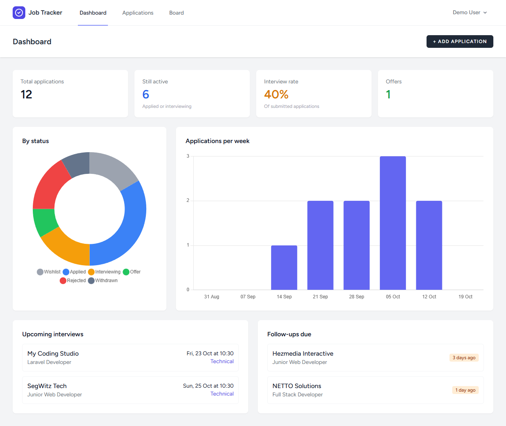
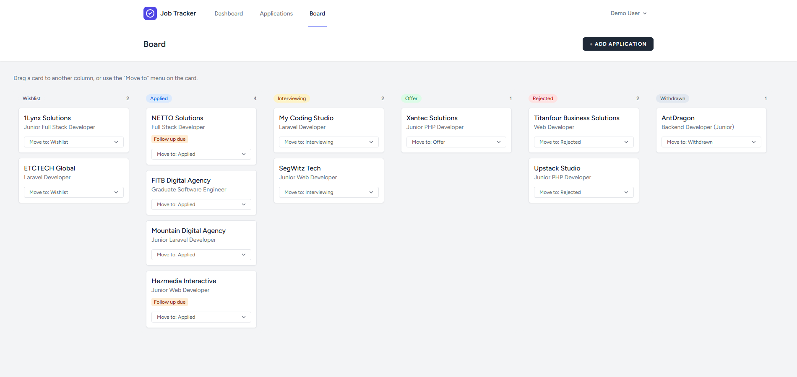
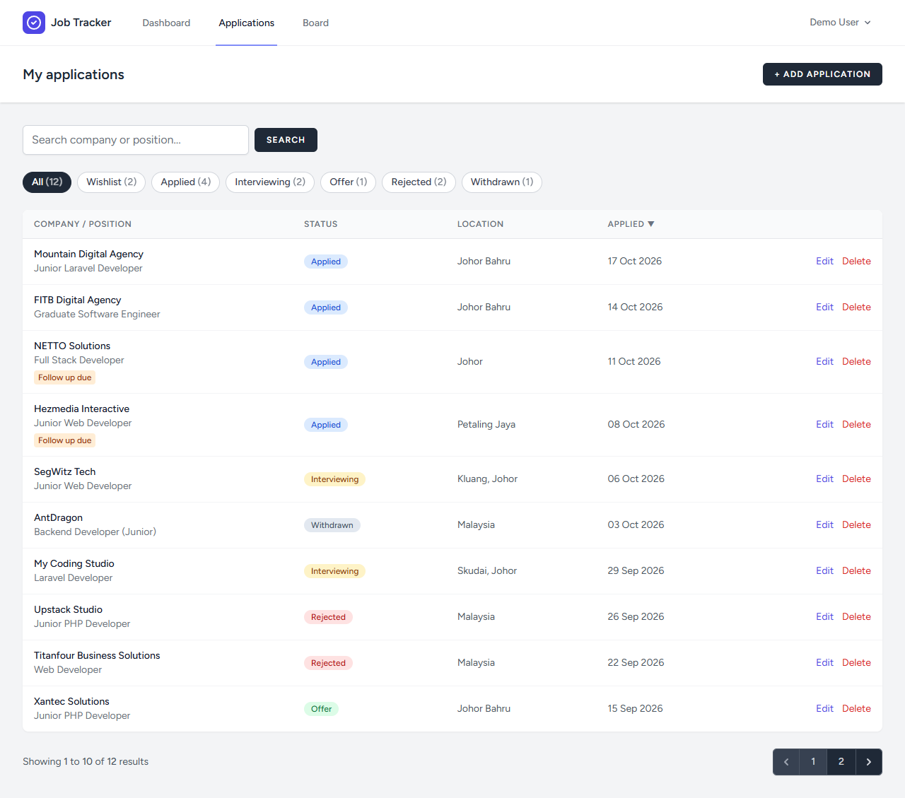
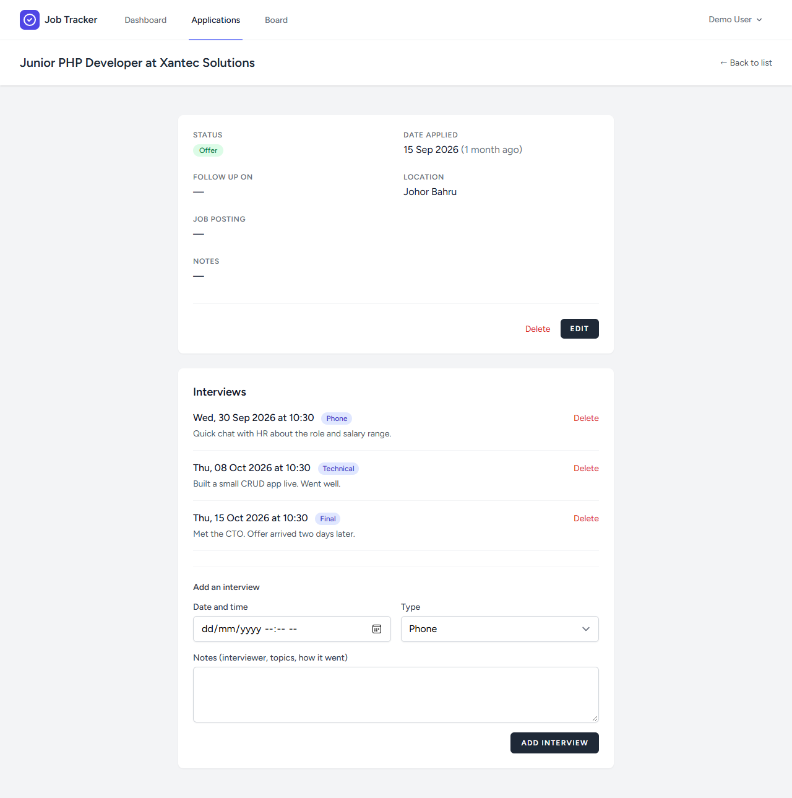
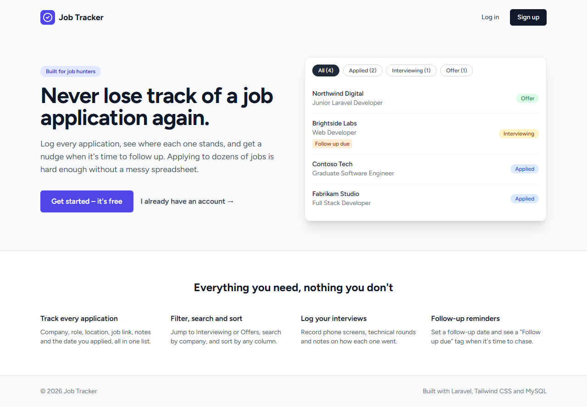

# Job Tracker

A Laravel web app for keeping track of job applications, interviews and follow-ups, with a kanban board and a stats dashboard.

**Live demo:** https://job-tracker-production-5c22.up.railway.app
Log in with **demo@example.com / DemoPass123** (sample data, public account, feel free to click around).
*The demo runs on a Railway trial plan, so it may go offline after a while. The screenshots below show what it looks like.*

Built with **Laravel 12**, **Laravel Breeze** (Blade + Tailwind CSS), **MySQL** and **Chart.js**.

## Screenshots

**Dashboard**: totals, interview rate, status breakdown, applications per week, upcoming interviews and follow-ups.



**Kanban board**: drag a card to another column, or use the "Move to" menu on touch screens and keyboards.



**Applications list**: filter by status, search, sort by any column.



**Application details**: everything about one application, plus its interview log.



<details>
<summary>Landing page</summary>



</details>

## Features

- Register, log in and reset your password (Laravel Breeze)
- Create, edit, view and delete job applications
- Status filter tabs with live counts, search by company or position, sortable columns, pagination
- Log interviews (date, type, notes) against each application
- Follow-up dates, with a "Follow up due" flag on open applications
- Kanban board with drag and drop (plain JavaScript and `fetch`, no library)
- Dashboard with totals, interview rate and two Chart.js charts
- Every user only sees and changes their own data
- 64 automated tests (Laravel's Breeze auth tests plus my own)

## Tech stack

| Area | Choice |
| --- | --- |
| Backend | PHP 8.2, Laravel 12 |
| Database | MySQL (SQLite in memory for tests) |
| Frontend | Blade templates, Tailwind CSS, Alpine.js (from Breeze), Chart.js |
| Auth | Laravel Breeze |
| Hosting | Railway (app and MySQL) |

## What I practised building this

- **Authorization with policies.** Every read or write of an application or interview checks that it belongs to the logged-in user (`app/Policies`). Tests prove another user gets a 403.
- **Form Requests and enum validation.** Validation lives in `app/Http/Requests`, and statuses and interview types are backed PHP enums, cast on the models.
- **Eloquent relationships.** User has many applications, an application has many interviews, with cascading deletes in the migrations.
- **Safe sorting.** The sort column comes from the URL, so it is checked against an allow-list before it reaches the query.
- **A little JavaScript on top of server-rendered pages.** The board moves cards optimistically and tells the server with `fetch`; if the save fails, the card jumps back. Charts get their data as JSON from the controller.
- **Testing.** Feature tests cover CRUD, filtering, search, sorting, interviews, the board, the dashboard and the demo seeder.
- **Deploying.** Running behind Railway's HTTPS proxy needed trusted proxies, environment variables and a migrate step on deploy.

## Running locally (Windows + XAMPP)

Requirements: PHP 8.2+, Composer, Node.js 20+ and MySQL (XAMPP).

```bash
git clone https://github.com/arish-tayalan/job-tracker.git
cd job-tracker
composer install
npm install
copy .env.example .env
php artisan key:generate
```

Create a MySQL database called `job_tracker` (phpMyAdmin or `mysql -u root`), then set these in `.env`:

```
DB_CONNECTION=mysql
DB_DATABASE=job_tracker
DB_USERNAME=root
DB_PASSWORD=
```

```bash
php artisan migrate --seed
npm run build
php artisan serve
```

Open http://127.0.0.1:8000 and log in with the seeded account **test@example.com / password**.

### Demo data

To add the same demo account as the live site (works in production too, no Faker needed):

```bash
php artisan db:seed --class=DemoSeeder
```

Log in with **demo@example.com / DemoPass123**. Running it again resets only that account.

## Running the tests

```bash
php artisan test
```

## Deploying to Railway

1. Create a Railway project from this GitHub repo and add a **MySQL** database service.
2. On the app service set these variables:

   | Variable | Value |
   | --- | --- |
   | `APP_NAME` | `Job Tracker` |
   | `APP_KEY` | output of `php artisan key:generate --show` |
   | `APP_ENV` | `production` |
   | `APP_DEBUG` | `false` |
   | `APP_URL` | your Railway domain, e.g. `https://job-tracker.up.railway.app` |
   | `DB_CONNECTION` | `mysql` |
   | `DB_URL` | `${{MySQL.MYSQL_URL}}` |
   | `LOG_CHANNEL` | `stderr` |

3. Settings: build command `npm run build`, pre-deploy command `php artisan migrate --force`, and turn on **Auto deploy**.
4. Under **Settings > Networking**, click **Generate Domain**.
5. Optional: in the service **Console**, run `php artisan db:seed --class=DemoSeeder --force` to add the demo account.

## Project structure (the interesting bits)

| File | What it does |
| --- | --- |
| `routes/web.php` | All routes, including the resource routes for applications |
| `app/Models/JobApplication.php` | Eloquent model (`belongsTo` User, `hasMany` Interview) |
| `app/Enums/ApplicationStatus.php`, `InterviewType.php` | Backed enums with labels and badge colours |
| `app/Http/Controllers/JobApplicationController.php` | List, filter, search, sort, create, show, update, delete, status change |
| `app/Http/Controllers/InterviewController.php` | Add and delete interviews |
| `app/Http/Controllers/BoardController.php` | Groups applications into kanban columns |
| `app/Http/Controllers/DashboardController.php` | Stats queries and chart data |
| `app/Http/Requests/` | Validation rules |
| `app/Policies/JobApplicationPolicy.php` | Only the owner may view, edit or delete |
| `resources/views/` | Blade views, including a reusable `sortable-th` component |
| `resources/js/board.js`, `dashboard.js` | Drag and drop, and Chart.js charts |
| `database/seeders/DemoSeeder.php` | Demo account with fixed sample data |
| `tests/Feature/` | Feature tests |

## Ideas for later

- Attach the CV or cover letter sent to each application
- Email reminders for interviews and follow-ups
- Export applications to CSV
